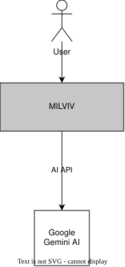

# 3. Контекст и сфера применения

Данный раздел описывает границы системы MILVIV, её основных участников и внешние системы, с которыми она взаимодействует.

На текущем этапе MILVIV взаимодействует с авторизованным пользователем и внешним AI-провайдером Google Gemini. Пользователь использует MILVIV для управления своими целями, проектами, задачами, планами и наградами. Google Gemini используется для анализа пользовательских данных и формирования структурированных результатов для MILVIV.

| Участник          | Входные данные                                                                                                             | Выходные данные                                                                                                             |
| ----------------- | -------------------------------------------------------------------------------------------------------------------------- | --------------------------------------------------------------------------------------------------------------------------- |
| **Пользователь**  | Данные для регистрации и авторизации, цели, проекты, задачи, награды, планы, сообщения для AI-ассистента, подтверждение предложений AI | Созданные и изменённые сущности, аналитика, результаты AI-анализа                                                           |
| **Google Gemini** | Пользовательские данные и инструкции для анализа или формирования структуры сущности                                       | Результат AI-анализа или структурированный результат, который MILVIV может использовать для создания или изменения сущности |

## Технический контекст

| Участник | Протокол | Формат данных |
| -------- | -------- | ------------- |
| Клиент пользователя | HTTP/1.1 (Jetty) | JSON, REST |
| Google Gemini | HTTPS, внешний API | JSON |
| PostgreSQL | JDBC поверх TCP | SQL |

Секреты доступа (ключ Gemini, учётные данные БД) передаются через переменные окружения и не хранятся в репозитории (OC-01).
