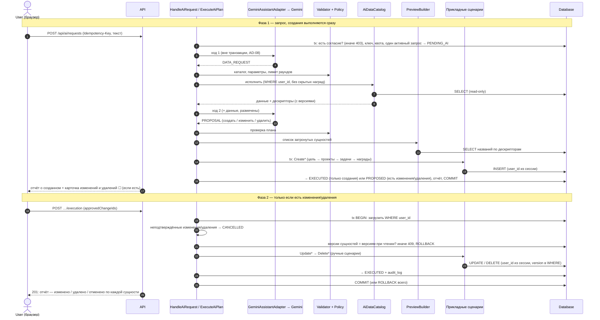

# AI Assistant — Архитектура

[← AI Assistant](README.md) · Метки [Ф] [Р] [П] [Т] [TO] [Д] — см. [README](README.md).

Компоненты, кто за что отвечает, последовательность взаимодействия.

---

## 4. Proposed architecture

### 4.1 Проверка исходной схемы из постановки

В постановке задачи была предложена цепочка: `User → API → AI Orchestrator → AI Provider → Structured AI Response → Schema Validation → Authorization → Business Validation → Limits / Policy → Execution → Domain → Database`, с просьбой проверить её и поправить. Этапы в ней верные, но порядок и форма требуют уточнений:

1. **Часть проверок — до обращения к AI.** В исходной схеме авторизация и лимиты стоят *после* ответа AI. Но если пользователь не дал согласие на использование данных или исчерпал свой лимит запросов, узнавать это после вызова AI поздно: мы уже потратили бесплатную квоту и отправили данные в Google. Поэтому согласие и лимиты проверяются **до** вызова AI. Права проверяются ещё дважды: когда AI просит данные (только данные этого пользователя) и когда выполняются изменения.
2. **Изменения и удаления — отдельным запросом.** В исходной схеме всё идёт одной линией до БД. Но пользователь должен подтвердить изменения и удаления, а между ответом AI и нажатием кнопки может пройти сколько угодно времени. Поэтому они выполняются вторым HTTP-запросом («Выполнить отмеченное»), а до него план хранится на сервере. Создания выполняются в первом запросе, без ожидания [Р G-25].
3. **AI может несколько раз попросить данные.** Прямая линия не учитывает, что AI сначала говорит «покажи мои проекты», получает их и только потом отвечает. Это цикл, и он ограничен: не больше 2 раз, иначе модель могла бы бесконечно тратить квоту.
4. **Проверка структуры ответа — три шага.** (1) Мы передаём Gemini схему ответа — это лишь *подсказка*, модель может её нарушить. (2) Сервер строго разбирает JSON: лишнее поле, неизвестный тип → отказ. (3) Сервер проверяет значения: длины, количества, дескрипторы. Обязательны шаги 2 и 3: подсказке модели доверять нельзя.
5. **Бизнес-правила проверяются два раза.** Первый раз сразу после ответа AI: если план нарушает правило (например, срок задачи позже срока проекта), AI получает шанс исправиться, а пользователь не видит заведомо невыполнимую карточку. Второй раз — в момент выполнения, внутри домена: за время ожидания подтверждения данные могли измениться.
6. **Для изменений и удалений нужен шаг «кого затронет».** Сервер по дескрипторам находит сущности в БД и берёт их настоящие названия для карточки.
7. **«AI Orchestrator» — не отдельный слой.** Это обычный прикладной сценарий (`HandleAiRequest`) в слое `application`, как любой другой. Отдельный фреймворк для этого не нужен.

### 4.2 Компоненты

| Компонент | Слой [Ф 5.1] | Проблема, которую решает | Почему не проще |
|-----------|--------------|--------------------------|-----------------|
| `AiRequestController` + DTO | presentation | Отправить, прочитать, подтвердить, отклонить | Клиентский контракт ≠ контракт AI |
| `HandleAiRequest` | application/ai | Фаза 1: проверки → цикл «AI ↔ данные» → валидация → **исполнение созданий** → карточка для изменений → сохранение | Это и есть orchestrator |
| `ExecuteAiPlan` | application/ai | Исполнение операций через ручные сценарии, одной транзакцией. Вызывается дважды: для созданий (из фазы 1) и для подтверждённых изменений и удалений (фаза 2) | Один код исполнения для обоих случаев |
| `AiConsentService` + репозиторий | application/ai, infrastructure | Хранит и проверяет согласие на использование данных | Проверка на сервере обязательна [Р G-12]; одна точка вместо проверок в каждом сценарии |
| `AiAssistantPort` | application/ai | Отвязка от провайдера, фейк в тестах | — |
| `AiDataCatalog` | application/ai | Исполняет только каталожные запросы, с `user_id`, без скрытых наград, с проекцией; выдаёт дескрипторы | Одна точка, где решается, что видит AI (QG-01, G-5) |
| `HandleRegistry` | application/ai | Дескриптор ↔ (тип, ID, **версия при чтении**) | Без него модель видит ID; без версии нельзя обнаружить, что сущность изменилась после предпросмотра |
| `AiResponseValidator` + `AiPolicy` | application/ai | Поля, лимиты, дескрипторы, конфликты операций | Переиспользует `shared/validation` [Ф] |
| `PreviewBuilder` | application/ai | Список затронутых сущностей для карточки: тип, название, ID — из БД | Без него карточка показывала бы названия со слов AI |
| `OperationReportBuilder` | application/ai | Отчёт после исполнения по фактическому результату транзакции [Р G-21] | Отчёт не должен зависеть от того, что написала модель |
| `AiRequest`, `ValidatedPlan` | domain/ai | Состояние, согласие, идемпотентность | — |
| `GeminiAssistantAdapter` | infrastructure/ai/gemini | Многоходовый HTTP, схема, таймауты, ретраи, разбор, квота провайдера | Весь провайдерский код в одном месте |
| `AiRequestJdbcRepository` | infrastructure/persistence | Хранение, фильтр `user_id` [Ф AD-14] | — |
| `AiConfig` | infrastructure/config | Все лимиты и константы AI с дефолтами, проверка при старте ([§8](limits-and-security.md)) | По образцу `AppConfig` [Ф]; без него числа разбросаны по коду |
| `FakeAiAssistant` | test | Сценарии ходов без модели | — |

**Не вводится:**
- rule engine;
- шина команд;
- произвольные запросы данных;
- сравнение «было → стало» (не нужно [Р G-21]).

### 4.3 Модели данных

```
Gemini JSON                                        ← только в адаптере
   ▼
AiTurn v1 (DATA_REQUEST | PROPOSAL | ANSWER | CLARIFICATION_NEEDED | REFUSED)   ← НЕДОВЕРЕННЫЙ
   ├─ DATA_REQUEST → AiPolicy → AiDataCatalog → DataResults (+ дескрипторы) → следующий ход
   └─ PROPOSAL → AiResponseValidator + AiPolicy → PreviewBuilder
                    ▼
               ValidatedPlan    ← дескрипторы → ID; версии; названия затронутых; itemId
                    │  ExecuteAiPlan: создания сразу; изменения/удаления — по согласию
                    ▼
               Create*/Update*/Delete* Command   ← те же, что у ручного API
                    ▼
               Domain → Database
```

Модели три, а не две: новым сущностям ещё нужны ID, дескрипторы нужно разрешить, а для карточки нужно хранимое представление плана.

### 4.4 Ответственность

| Участник | Отвечает | Не может |
|----------|----------|----------|
| User | Сообщение; **явное согласие** на каждое изменение и удаление; отклонение | Задать лимиты, владельца, состав данных для AI |
| API | Аутентификация, DTO, валидация ввода | Логика |
| Orchestrator | Квоты, цикл, проверки, предпросмотр, хранение, транзакции | Знать формат Gemini |
| AI Provider | Намерение, запросы данных, план, ответ | Инструменты, сеть, БД, ID, скрытые награды |
| Validator / Policy | Типы, лимиты, каталог, дескрипторы, конфликты | Владение |
| `AiDataCatalog` | Что видит AI | Исполнять что-либо вне каталога |
| `PreviewBuilder` | Какие сущности увидит пользователь в карточке | Опираться на текст AI |
| Application/Domain | Инварианты, атомарность, баллы | — |
| Database | FK, CHECK — последний рубеж | — |

**AI разрешено:**
- запрашивать данные из каталога: задачи, проекты, нескрытые награды, рефлексии, планы, цели ([§6.3](contract.md));
- **создавать** цели, проекты, задачи (в том числе одиночные), награды;
- **изменять** поля целей, проектов, задач, нескрытых наград из белого списка ([§6.5](contract.md)), включая перенос задачи в другой проект или цель;
- **удалять** цели, проекты, задачи, нескрытые награды;
- предлагать баллы задачи (1..1000) или оставлять их по сложности;
- отвечать текстом, уточнять, отказываться.

**AI запрещено** (запрет обеспечен конструкцией):
- SQL, произвольные фильтры, любые вызовы вне каталога;
- чужие данные: параметра «пользователь» нет, `user_id` берётся из сессии;
- **скрытые награды** — ни чтение, ни изменение, ни удаление, ни знание о существовании (G-5);
- реальные ID — только дескрипторы;
- исполнять изменения и удаления без согласия пользователя — решает сервер по подтверждению;
- менять статус (выполнить, отменить), скрытость, пароль, владельца, баланс; обменивать баллы на награды (G-16);
- изменять или удалять планы и рефлексии — только чтение.

**Итоговый принцип [П]:** *AI запрашивает данные и предлагает черновик. Сервер решает, что отдать, проверяет права, правила и лимиты и показывает, какие сущности будут затронуты. Пользователь соглашается на каждое изменение и удаление отдельно. Сервер исполняет тем же кодом, что и ручные действия.*

---

## 5. Interaction sequence



Если AI предложил только создания, фазы 2 нет. Фаза 1 занимает 10–60 с. Она синхронная, на виртуальных потоках [П, TO]. Статус `PENDING_AI` оставляет путь к асинхронной схеме.
