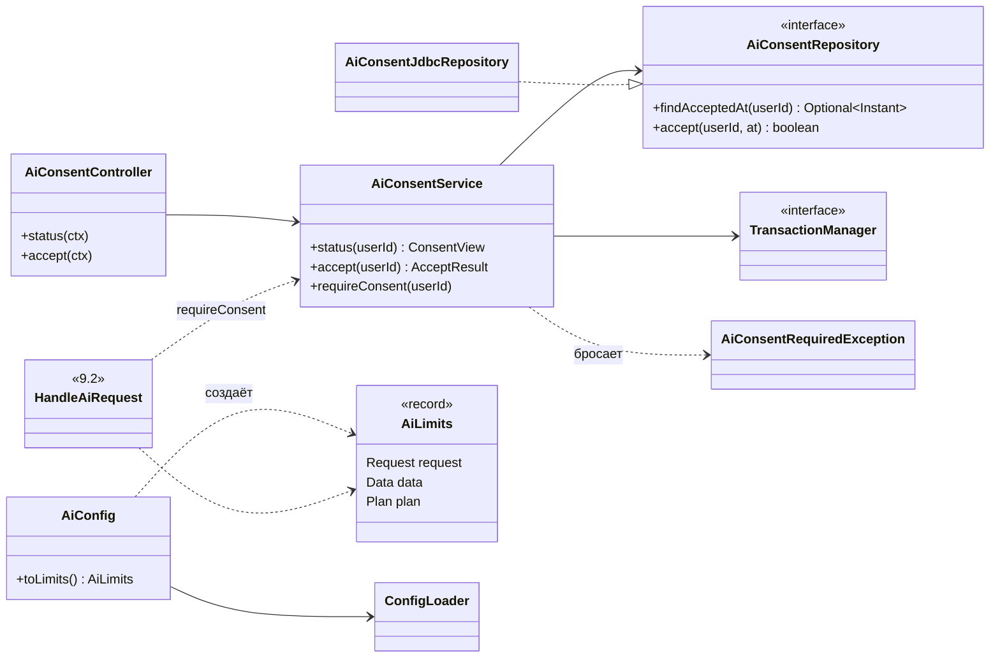

# AI Assistant — Реализация по подэтапам

[← AI Assistant](README.md)

Этап 9 делится на подэтапы. Каждый **сначала проектируется** здесь (классы, схема связей, решения на подтверждение), затем реализуется. После реализации раздел подэтапа сверяется с кодом.

**Статусы:** ✅ реализовано · 📐 спроектировано, ждёт подтверждения · ⏳ не начато.

| # | Подэтап | Что появляется | Статус |
|---|---------|----------------|--------|
| 9.1 | Согласие и конфиг | `ai_consents`, `GET/POST /ai/consent`, проверка согласия, `AiConfig` со всеми лимитами [§8](limits-and-security.md) | ✅ |
| 9.2 | Каркас запроса | `AiRequest` (состояния, идемпотентность, один активный запрос), `AiAssistantPort` + `FakeAiAssistant`, `HandleAiRequest` для исходов `ANSWER` / `CLARIFICATION_NEEDED` / `REFUSED`, `POST /ai/requests`, `GET /ai/requests/{id}` | ⏳ |
| 9.3 | Создания | Создающая часть `PlanDraft`, `AiResponseValidator` + `AiPolicy`, `ExecuteAiPlan` (фаза 1 через ручные сценарии, одна транзакция), `OperationReportBuilder` | ⏳ |
| 9.4 | Каталог данных | `AiDataCatalog` (6 запросов, проекции, урезание, без скрытых наград), `HandleRegistry` (дескрипторы с версией), цикл ≤ 2 раундов, журнал прочитанного, создание внутри существующих целей и проектов | ⏳ |
| 9.5 | Изменения и удаления | Изменения и удаления в плане, `PreviewBuilder`, `PROPOSED`, `POST /ai/requests/{id}/execution` и `/rejection`, сверка версий (`TARGET_CHANGED`), правила дат на итоговом состоянии, TTL | ⏳ |
| 9.6 | Адаптер Gemini | Провайдерские ключи `AiConfig`, JDK `HttpClient`, промпт `assistant@1`, схема ответа, строгий разбор, таймауты, ретраи, `AiFailure`; тесты на HTTP-заглушке; онлайн-прогон ~25 сообщений (п. 10 [§17](README.md#17-final-architecture)) | ⏳ |
| 9.7 | Квоты и предохранитель | Лимиты на пользователя (сутки, минута, созданий в сутки), предохранитель квоты провайдера, зависшие `PENDING_AI` | ⏳ |
| 9.8 | Память AI | `ai_memories`. В концепции не описана — только в пользовательской доке; проектируется отдельно | ⏳ |

Порядок — из [§17](README.md#17-final-architecture): пункты 1–3 (аутентификация, миграции, ручные CRUD) сделаны этапами 1–6; пункт 5 разбит на 9.2 и 9.3; пункт 10 (онлайн-прогон) входит в 9.6. До 9.6 настоящего провайдера нет: всё проверяется на `FakeAiAssistant`.

### Расхождения концепции с кодом — учесть в подэтапах

Концепция писалась до этапов 1–8. Что в коде устроено иначе и где это всплывёт:

| # | В концепции | В коде | Подэтап | Что делать |
|---|-------------|--------|---------|------------|
| K-1 | Пути `/api/ai/...` | Префикса `/api` нет ни у одного модуля | 9.1 | `/ai/...` — решение 1 ниже |
| K-2 | `AiConfig` передаётся в `AiPolicy`, `AiDataCatalog` | `application` не может импортировать `infrastructure` | 9.1 | `AiConfig` → `AiLimits` (application), как `AuthConfig` → `AuthPolicy` |
| K-3 | Ключи с дефолтами — в `application.properties` | Там только БД, сервер, логи; ключи `AUTH_*`, `CALENDAR_*` и др. — только в `.env.example` | 9.1 | Записать ключи `ai.*` в `application.properties` (по §8); остальные модули — отдельно, по желанию |
| K-4 | Пользователь и AI работают в часовом поясе (`timezone` в ходе 1) | Часового пояса пользователя нет; все даты — UTC | 9.2 | Передавать `UTC`, пока часовой пояс не появится |
| K-5 | ID в отчёте — числа (`"id": 89`) | ID — UUID | 9.3 | В отчёте UUID |
| K-6 | `userId` из `rest/filters` (D-01) | Аутентификация в `RouterScanner` + `JwtCookieAuthenticator` | — | Только текст концепции |
| K-7 | Каждая операция → `audit_log` (§13) | `audit_log` никто не пишет (R-03) | 9.3 | Решить: писать журнал с этого подэтапа или отложить |
| K-8 | `LIST_TASKS(unassigned?, period?)`, `LIST_REFLECTIONS(task?, period?)` | В `TaskFilter` нет «без проекта и цели» и периода; ответы рефлексии — без фильтров | 9.4 | Расширить репозитории |
| K-9 | Правила дат — на итоговом состоянии плана | Ручные сценарии проверяют каждую операцию отдельно | 9.5 | Порядок исполнения: сначала проекты, чей срок растёт, затем задачи, затем проекты, чей срок уменьшается. Так любое промежуточное состояние допустимо, если допустимо итоговое |
| K-10 | Интеграционные тесты — Testcontainers + PostgreSQL | Docker нет, тесты на H2 | все | H2; тест на PostgreSQL пишется, но пропускается без Docker |
| K-11 | Новой задаче ничего не назначается | Ручной `TaskCommands.create` назначает стандартные вопросы рефлексии (этап 6) | 9.3 | Задачи от AI получат их тоже — следствие принципа 5 |

---

## 9.1 Согласие и конфиг ✅

**Задача.** Без согласия на использование данных AI недоступен [Р G-12]. Согласие даётся один раз, отзыва нет [Р G-24]. Все лимиты AI — в одном конфиге с дефолтами [§8](limits-and-security.md).

**В подэтап не входит:** вызов AI. `requireConsent` появляется сейчас, а вызывать его будет `HandleAiRequest` из 9.2.

### Классы

| Класс | Слой | Ответственность |
|-------|------|-----------------|
| `AiConsentController` | presentation | `GET /ai/consent`, `POST /ai/consent` |
| `AiConsentService` | application/ai | Узнать статус, дать согласие, проверить согласие перед вызовом AI |
| `ConsentView`, `AcceptResult` | application/ai | Ответ: `accepted`, `acceptedAt`; признак «согласие записано сейчас» |
| `AiLimits` | application/ai | Типизированные лимиты: `Request`, `Data`, `Plan` — вложенные records |
| `AiConsentRepository` | domain/ai | Интерфейс хранилища согласий |
| `AiConsentRequiredException` | domain/exception | `403 AI_CONSENT_REQUIRED` |
| `AiConsentJdbcRepository` | infrastructure/persistence | Таблица `ai_consents` (V14) |
| `AiConfig` | infrastructure/config | Читает `AI_*` / `ai.*` один раз при старте, проверяет, выдаёт `AiLimits` (K-2) |
| `HttpStatusResolver` | infrastructure/http | Новый код `AI_CONSENT_REQUIRED` → 403 |

### Схема связей



### Как работает

- `POST /ai/consent` записывает `accepted_at`, если согласия ещё нет. Повтор ничего не меняет и возвращает исходную дату. Одновременные запросы одного пользователя идут по очереди: перед вставкой блокируется его строка в `users`.
- `requireConsent(userId)` — одна точка проверки для всех будущих `/ai/requests*`. Нет согласия → `AiConsentRequiredException` до любого обращения к провайдеру.
- `AiConfig` по образцу `AuthConfig`: ключ env `AI_*`, property `ai.*`, дефолт в коде, проверка при старте (положительные, `min ≤ max`). Наружу отдаёт только `AiLimits` — application не импортирует infrastructure.

**Состав `AiLimits`** (дефолты — из [§8](limits-and-security.md)):

| Группа | Значения |
|--------|----------|
| `Request` | длина сообщения 2000; запросов 20 в сутки и 3 в минуту; вызовов AI на запрос 4; таймаут запроса 90 с; TTL плана 24 ч; созданий в сутки 200; предохранитель 60 мин |
| `Data` | раундов 2; запросов за раунд 3; элементов 100; длина текста 1000; токенов данных 16000 |
| `Plan` | созданий 40, изменений 20, удалений 10; проектов 10, задач в узле 10, задач всего 30, наград 3; title 100, description 1000, summary 500, answer 2000; горизонт дат 2 года; стоимость награды 100 000 |

Провайдерские ключи (`AI_PROVIDER`, `AI_MODEL`, `GEMINI_API_KEY`, таймауты HTTP, ретраи, размер ответа, `maxOutputTokens`) добавляются в 9.6 вместе с адаптером. Это **отступление от §8**, где они в одной таблице с остальными: так приложение запускается без ключа Gemini, пока адаптера нет.

Ключи `ai.*` с дефолтами записываются в `application.properties`, пример — в `.env.example` (K-3).

### API

```http
GET  /ai/consent   → 200 { "accepted": false, "acceptedAt": null }
POST /ai/consent   → 201 { "accepted": true, "acceptedAt": "2026-10-11T12:00:00Z" }   (повтор → 200, та же дата)
```

### Решения на подтверждение

1. **Путь `/ai/...`, а не `/api/ai/...`**, как в концепции: у остальных модулей префикса `/api` нет (K-1).
2. **Повтор `POST /ai/consent` → 200** с исходной датой (первый → 201).
3. **`AiConfig` сразу со всеми лимитами**, кроме провайдерских. Часть значений до 9.3–9.7 не используется, зато лимиты в одном месте с первого дня, как требует [§8](limits-and-security.md).

### Сверка с концепцией

| Требование концепции | Где | В проекте |
|----------------------|-----|-----------|
| Компоненты `AiConsentService` + репозиторий, `AiConsentController` | [§4.2](architecture.md), [§17](README.md#17-final-architecture) | ✅ |
| Согласие один раз, без отзыва и версии текста | G-12, G-24 | ✅ |
| `GET` → `accepted`, `acceptedAt`; `POST` → 201 | [§6.10](user-flow.md) | ✅ + повтор → 200 (решение 2) |
| Проверка на сервере, до вызова провайдера, `403 AI_CONSENT_REQUIRED` | [§6.10](user-flow.md), [§11](reliability.md), инвариант 5 | ✅ точка проверки готова, вызов — в 9.2 |
| Согласие хранится бессрочно; удаляется вместе с пользователем | [§13](data.md) | ✅ `ON DELETE CASCADE` из V14 |
| Все лимиты в `AiConfig` с дефолтами, проверка при старте | [§8](limits-and-security.md) | ✅ кроме провайдерских — в 9.6 |
| Новые коды — в `HttpStatusResolver` | [§11](reliability.md) | ✅ |
| Тест: каждый `errorCode` есть в `HttpStatusResolver` | [§12](development.md) | ✅ для `AI_CONSENT_REQUIRED` |
| Текст окна согласия (что читается, что данные уходят Google, бесплатный тариф) | [§6.10](user-flow.md) | — задача фронтенда, сервер текст не хранит |

### Сверка с кодом (после реализации)

- Классы и связи — как в схеме. API — [ai-api.md](../../../../rest-api/ai-api.md).
- Решения 1–3 приняты.
- **Уточнение:** «уже согласен» при одновременных запросах — не перехват нарушения ключа (в PostgreSQL ошибка прерывает транзакцию), а блокировка строки пользователя перед вставкой.
- **Дополнительные проверки `AiConfig`:** запросов в минуту ≤ в сутки; задач в узле ≤ задач всего; задач, проектов и наград ≤ созданий в плане; созданий в плане ≤ созданий в сутки.
- Ключи `ai.*` записаны в `application.properties`, закомментированный пример — в `.env.example` (K-3 для AI закрыт).

### Тесты

- Сервис: без согласия → статус `accepted: false`, `requireConsent` бросает; после `accept` — проходит; повтор `accept` не меняет дату.
- H2: запись и чтение; изоляция пользователей; повторная вставка не падает.
- `AiConfig`: дефолты; переопределение; отказ при нуле, отрицательном значении, `min > max`.
- `HttpStatusResolver`: `AI_CONSENT_REQUIRED` → 403.
