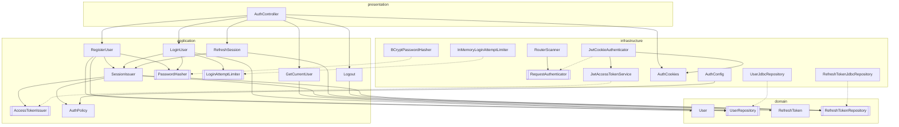

# Аутентификация

Вход по email и паролю. Без входа доступны только маршруты с `@Public` (AR-05).

## Токены

| | Access-токен | Refresh-токен |
|---|---|---|
| Формат | JWT, подпись HS256 | Случайные 256 бит, base64url |
| Срок | 15 минут | 30 дней, продлевается при обновлении; не дольше 90 дней от входа |
| Хранение на сервере | Нет | SHA-256 хеш в `refresh_tokens` |
| Cookie | `__Host-access_token`, `Path=/` | `__Secure-refresh_token`, `Path=/auth` |
| Отзыв | Истекает сам | Сразу: выход или повторное использование |

Почему refresh-токен не JWT: его нужно отзывать, а для этого он всё равно хранится на сервере — подпись ничего не добавляет.

## Правила

- Токены только в cookie `HttpOnly; Secure; SameSite=Strict` — JavaScript их не видит (XSS), чужие сайты их не отправят (CSRF). В теле ответа токенов нет.
- JWT: алгоритм фиксирован (HS256), `alg` из заголовка не используется, подпись сравнивается за постоянное время, проверяются `iss` и `exp` (RFC 8725). Секрет — `AUTH_JWT_SECRET`, не короче 256 бит; без него приложение не стартует.
- Ротация: каждое обновление выдаёт новый refresh-токен, старый отзывается. Предъявление уже отозванного токена — признак кражи: отзывается вся сессия (`family_id`), нужен новый вход (RFC 9700).
- Пароль: BCrypt, cost 12; 8–64 символа и не больше 72 байт (дальше BCrypt обрезает).
- Вход: одна ошибка для «нет email» и «неверный пароль», время ответа одинаковое (сверка с фиктивным хешем). После 5 неудачных попыток на email — 429 на 15 минут (в памяти процесса).
- Маршрут закрыт по умолчанию: `RouterScanner` проверяет токен перед обработчиком без `@Public`. Id пользователя — `ctx.userId()`.

## Классы

Сплошная стрелка — «использует», пунктирная — «реализует интерфейс». Все стрелки направлены внутрь, к `domain` (AD-02). `application` объявляет интерфейсы, `infrastructure` их реализует, поэтому сценарии не знают ни про JWT, ни про BCrypt, ни про SQL. Связывает реализации с интерфейсами только `Main`.

Двойная рамка — интерфейс. Все сценарии ещё используют `TransactionManager` и `Clock`; на схеме эти стрелки не показаны, чтобы не загромождать её.

| Класс | Слой | Отвечает за |
|-------|------|-------------|
| `AuthController` | presentation | Принять запрос, проверить DTO, вызвать сценарий, записать cookie |
| `RouterScanner` | infrastructure/http | Регистрирует маршруты; перед обработчиком без `@Public` вызывает `RequestAuthenticator` |
| `RequestAuthenticator` | infrastructure/http | Интерфейс проверки входа |
| `JwtCookieAuthenticator` | infrastructure/security | Достать access-токен из cookie, проверить, записать `userId` в `HttpContext` |
| `JwtAccessTokenService` | infrastructure/security | Выпустить и проверить JWT |
| `AuthCookies` | infrastructure/security | Имена и атрибуты cookie; запись, чтение, удаление |
| `BCryptPasswordHasher` | infrastructure/security | Хеш и проверка пароля |
| `InMemoryLoginAttemptLimiter` | infrastructure/security | Счётчик неудачных входов по email |
| `UserJdbcRepository`, `RefreshTokenJdbcRepository` | infrastructure/persistence | SQL для `users` и `refresh_tokens` |
| `AuthConfig` | infrastructure/config | Читает и проверяет `AUTH_*`, собирает `AuthPolicy` |
| `RegisterUser`, `LoginUser`, `RefreshSession`, `Logout` | application/auth | Сценарии: правила, транзакция, порядок шагов |
| `GetCurrentUser` | application/user | Данные текущего пользователя |
| `SessionIssuer` | application/auth | Начать сессию или ротировать токен: создать `RefreshToken`, выпустить access-токен |
| `PasswordHasher`, `AccessTokenIssuer`, `LoginAttemptLimiter` | application/auth | Интерфейсы, нужные сценариям; реализации — в infrastructure |
| `AuthPolicy` | application/auth | Сроки жизни токенов |
| `RefreshTokenCodec` | application/auth | Сгенерировать refresh-токен и посчитать его SHA-256 |
| `User`, `RefreshToken` | domain | Сущности: нормализация email, ротация и сроки токена |
| `UserRepository`, `RefreshTokenRepository` | domain | Интерфейсы хранилищ |

## API

Маршруты, запросы и ответы — [rest-api/auth-api.md](../../../rest-api/auth-api.md).

## Настройки

`AUTH_JWT_SECRET` (обязателен), `AUTH_JWT_ISSUER`, `AUTH_ACCESS_TOKEN_TTL_MINUTES`, `AUTH_REFRESH_TOKEN_TTL_DAYS`, `AUTH_SESSION_MAX_DAYS`, `AUTH_COOKIE_SECURE`, `AUTH_BCRYPT_COST`, `AUTH_LOGIN_MAX_ATTEMPTS`, `AUTH_LOGIN_WINDOW_MINUTES` — дефолты в `AuthConfig`.
